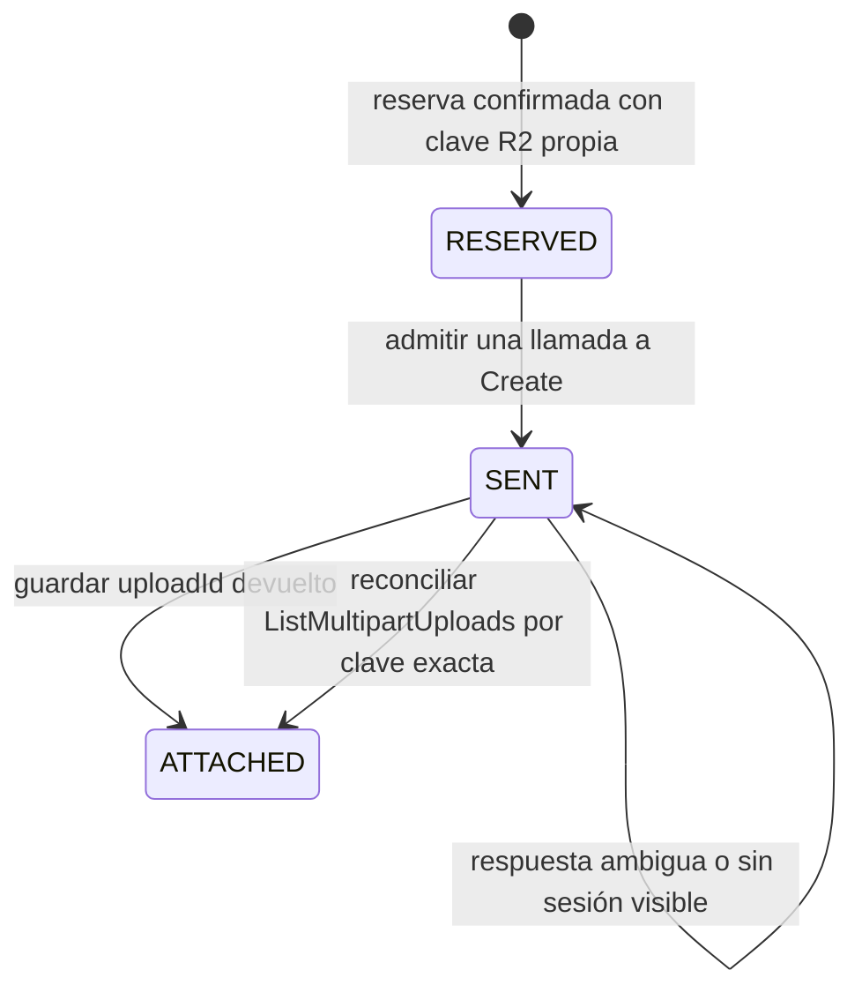

# Apertura e identidad de sesiones: D44

12 de noviembre de 2026, America/Mexico_City. Implementación local, sin desplegar.
Continúa D43; no cambia Flutter, manifiesto v3 ni el APK D41.

Actualización D45: [validación PostgreSQL y R2](subidas-moviles-validacion-infra.md)
cerrada en entorno aislado, con cuentas locales autenticadas y limpieza. No
equivale a despliegue ni a validación de la cuenta productiva de Juan Rodríguez.

## Admisión y reserva

AdmisionDeSubidas serializa aperturas por negocio con una fila de upload_scopes
y bloqueo de base de datos. La fila no contiene usuarios, archivos ni secretos.
Su creación inicial tolera la carrera de inserción por clave primaria. La
restricción existente `(tenant_id, client_upload_id)` sigue siendo la defensa
única de la sesión; las claves pertenecen al namespace del negocio, no se
reutilizan silenciosamente para otro propietario.

PUT simple y multipart pasan por esta admisión. En la transacción corta se
busca primero la misma clave, se valida identidad y, si es nueva, se comprueban
tipo, repetidos, cuota y contador diario antes de guardar una sola reserva.
Una respuesta repetida no pasa por otra reserva ni por otro cargo diario.
La llamada a CreateMultipartUpload se realiza después de confirmar esa fila,
fuera de la transacción y del bloqueo por negocio.

## Apertura remota recuperable

- RESERVED prueba que no se admitió todavía Create. Un worker puede continuar
  esa primera admisión después de una caída. Cancelar en esta fase impide que
  una recuperación posterior llegue a enviar Create.
- SENT se confirma antes de emitir la petición. No se vuelve a invocar Create
  para esa intención, ni al expirar el lease. Otro pedido obtiene el mismo
  assetId y estado OPENING mientras no se haya adjuntado la sesión remota.
- El cliente SDK dedicado a Create tiene cero reintentos y timeout total/de
  intento de dos minutos. El cliente general conserva su configuración anterior.
- Si se perdió la respuesta o la escritura posterior, el servidor conserva la
  clave R2 única en MediaAsset y consulta las aperturas por esa clave. Filtra
  igualdad exacta; un objeto que sólo comparte prefijo no es una coincidencia.
  La consulta pagina, rechaza cursores inválidos/repetidos y no presenta un
  fallo remoto como ausencia o éxito parcial.
- Si aparecen varios IDs, se persiste primero el elegido bajo bloqueo. Los
  recuperadores usan esa misma elección y abortan los demás antes de habilitar
  firmas. Si abortar falla, SENT y la clave conservan la tarea de reconciliación.
- ATTACHED habilita el flujo D43 de partes/finalización. Persistir el ID no cambia
  una decisión de cancelación que haya llegado durante Create: la recuperación
  continúa esa cancelación, sin publicar el archivo.

Cloudflare documenta ListMultipartUploads entre las operaciones compatibles de
su API S3. Esto verifica disponibilidad documental, no permisos ni comportamiento
del bucket de esta cuenta; sigue pendiente probarlo en R2 real.
[Referencia oficial de compatibilidad](https://developers.cloudflare.com/r2/api/s3/api/).

### Límite deliberado ante una apertura incierta

Un listado vacío **no demuestra** que una petición Create admitida nunca haya
llegado o vaya a terminar. SENT sin ID visible conserva reserva y se reconsulta;
no se crea otra sesión ni se declara cancelación efectiva por adivinar ausencia.
Existe una ventana de caída después de guardar SENT y antes del envío: puede
haber cero sesiones remotas y la intención seguirá incierta. Se prioriza no
duplicar ni perder la información sobre esa intención.

Si la incertidumbre persiste, requiere revisión operativa. No se promete progreso
automático ilimitado ni liberar cuota al cumplir 24 horas en este caso ambiguo.
Una cancelación guarda CANCELLING/EXPIRING y devuelve UPLOAD_OPENING_UNCERTAIN
hasta recuperar el ID y comprobar el aborto. No restablecer SENT a RESERVED ni
borrar la fila/clave a ciegas: eso permitiría otra llamada remota sin resolver la
anterior. Una reparación operativa exige detener/drenar el emisor anterior y
verificar el estado remoto con autorización aplicable.

Esto evita huérfanos deliberados causados por reservar después de Create o por
repetirlo automáticamente. No se afirma que exista una transacción atómica
entre PostgreSQL y R2, ni que toda pérdida de respuesta se resuelva sin revisión.

## Identidad inmutable

Se guarda uploadOwnerId, uploadDeclaredBytes, uploadProtocolVersion y un digest
SHA-256 de una representación con longitudes y nulos inequívocos. Incluye versión,
negocio, usuario obtenido de autenticación, modalidad, nombre original, MIME
normalizado, tamaño declarado, huella, lote e índice. No incluye JWT, URL firmada,
ruta local ni credenciales. No confundir este digest de metadatos con un SHA-256
de todos los bytes del archivo; la huella de archivo existente puede ser de
deduplicación y D43 sigue validando partes y tamaños reales.

La misma clave con identidad diferente responde UPLOAD_ID_CONFLICT. Se conserva
la frase compatible «otro archivo». Confirmar un medio reparado puede cambiar
su tamaño real, pero eso no cambia la identidad original ni fuerza otra reserva.
Cambiar el consentimiento de repetido no cambia la identidad: se validó al admitir
la reserva, no debe crear una sesión diferente al recuperarla.

El propietario queda ligado a la sesión. Otro usuario del mismo negocio no puede
reabrir, consultar estado, firmar, listar partes, confirmar ni cancelar esa sesión.
La galería y el uso normal de medios del negocio conservan sus rutas/permisos.
Workers internos sin autenticación actúan bajo el tenant impuesto antes de abrir
transacciones; los endpoints requieren autenticación y POST_CREATE.

## Selección del protocolo y compatibilidad

uploadProtocolVersion es opcional: ausente equivale a 1. La versión 2 exige
multipart, usuario autenticado, clientUploadId, huella, uploadBatchId e índice.
Los patrones y límites del DTO HTTP permanecen aplicables. Otras versiones o
pedidos incompletos se rechazan antes de reservar.

Una sesión previa sin identidad/propietario no se adopta como v2. Conserva su
recuperación v1 y permisos históricos por negocio; intentar convertirla mediante
un pedido v2 da UPLOAD_LEGACY_SESSION. No se asigna retroactivamente a quien
simplemente conozca su clave. Las aperturas nuevas v1 autenticadas también
guardan identidad y propietario. Una clave terminal no se reabre.

## Respuestas

| Respuesta | Campos y significado |
|---|---|
| MultipartUploadResponse | protocolVersion de la sesión; expiresAt UTC del plazo absoluto; nextCheckAt como orientación; estado OPENING/PENDING/READY o decisión de cancelación. Mantiene assetId y parámetros de partes. |
| MultipartPartsResponse | expiresAt del plazo de sesión; signedExpiresAt de la firma más próxima; cada signed incluye su expiresAt. expiresInSeconds se conserva para clientes anteriores. |
| SubidaEstadoResponse | versión, modalidad, metadatos/lote, parámetros multipart, expiresAt y nextCheckAt. READY no indica otro próximo intento. No revela propietario/digest/lease ni secretos. |
| StorageUsageResponse | multipartSessionVersion=2 para este contrato API; subidaEnFondo=1 permanece; multipartMobileReady=false. multipartFromBytes sigue controlando nuevas aperturas por negocio. |

Los tiempos se serializan como instantes ISO 8601 UTC terminados en Z. El plazo
de una sesión nueva sigue siendo 24 horas, con firmas acotadas al plazo menos
el margen D43. El vencimiento declarado no prueba que una operación remota
ambigua haya dejado de existir. nextCheckAt no garantiza el segundo exacto de
ejecución del worker. Un cliente v2 no debe enviar partes mientras estado sea
OPENING ni interpretar capacidad API como activación del motor móvil.

## Esquema y entrega

Propuesta aditiva, no ejecutada:
[sql/subidas-d44-apertura.sql](sql/subidas-d44-apertura.sql). Requiere D43;
agrega tabla de admisión y cinco columnas opcionales. Las filas anteriores no
se rellenan con un propietario supuesto. No hay borrado de datos ni de objetos.

Antes de desplegar: esquema y concurrencia en PostgreSQL real, respaldo verificado,
permisos ListMultipartUploads, pruebas R2 con respuestas perdidas y abortos,
entrega exacta revisada y autorización nueva. Drenar instancias/operaciones viejas;
no mezclar binarios que no conocen RESERVED/SENT con el nuevo coordinador.
Una reversión no debe exponer reservas pendientes a workers anteriores ni borrar
identidad/estado. El permiso cb483b7 no cubre este despliegue.

Las pruebas usan H2 en memoria, principal simulado y R2/S3 simulados. No sustituyen
autenticación de la cuenta conectada, PostgreSQL ni bucket real. Sin cambios en
Flutter/APK, publicación, commit/push, delegación o emulador. Con el contrato
validado operacionalmente, el trabajo siguiente será la migración explícita del
manifiesto y las tareas por rangos en Android; no introducir varias tareas en v3.

## Verificación final

**152/152 pruebas en trece clases**, cero fallos, errores u omisiones; Maven
exit 0, tiempo reportado 6 min 39 s. Son 124 anteriores más 22 casos de apertura
y seis del adaptador/configuración SDK. Incluye solicitudes simultáneas, reserva
visible antes de Create y sin transacción remota, identidad/propietario, pérdida
de respuesta, cancelación durante Create, ambigüedad conservadora, legado v1,
caída antes del envío, abortos de sobrantes y serialización UTC.

La primera compilación del auxiliar nuevo requirió concretar los tipos de sus
contadores para assertThat. La ejecución enfocada posterior aprobó 84 de 85;
el único fallo era la frase compatible «otro archivo», restaurada sin cambiar
la expectativa. Sus 18 casos nuevos de apertura y seis SDK ya pasaban. Los
cuatro casos de legado/negocio/reserva previos al envío se agregaron después y
están incluidos en la ejecución final de 22 casos.

Evidencia local:

- `target/subidas-d44-release.log`: ejecución final sobre fuentes congeladas.
- `target/subidas-d44-inputs.json`: veinte entradas seleccionadas de fuentes,
  configuración y SQL propuesto capturadas antes de ejecutar.
- `target/subidas-d44-report.json`: hashes coincidentes al terminar, trece XML
  frescos y conteo152 comprobado. No es snapshot total ni suite completa del repo.

No quedan comandos de D44 en ejecución. No se aplicó SQL en PostgreSQL, no se
subieron archivos reales a R2 y no hubo despliegue ni modificación de APK.
