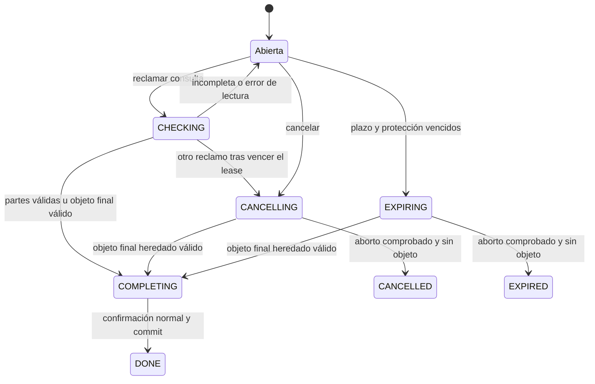

# Coordinación de subidas multipart: D43

Implementación local del 11 de noviembre de 2026, America/Mexico_City.
No desplegada. La app conserva PUT completo y el manifiesto v3.

Actualización del 12 de noviembre: D44 incorpora admisión de apertura antes de
Create, propietario/identidad y respuestas UTC/versionadas. Consulta el
[contrato de apertura](subidas-moviles-apertura.md) y el checkpoint actual; las
brechas de código enumeradas al final de este documento son el contexto D43.

## Resultado y política

HTTP, recuperación y limpieza comparten CoordinadorDeSubidas. La decisión se
guarda en la fila del medio con un bloqueo de escritura de base de datos. No
depende de un candado Java ni de que dos llamadas lleguen a la misma instancia.
Cada reclamo tiene un token UUID y vencimiento. Los accesos que deciden y
confirman son transacciones cortas; ListParts, unión, aborto y HEAD se realizan
fuera de esas transacciones.

El bloqueo usa MediaAssetUploadLocks: después de adquirirlo, refresh vuelve a
leer la fila vigente bajo ese mismo bloqueo. Una consulta con FOR UPDATE por sí
sola podía devolver la instancia antigua que una petición ya tenía administrada
en su contexto JPA. Se reprodujo ese fallo con un contexto abierto sin transacción
activa y una cancelación de otro hilo; el token antiguo no debe superar esa
revalidación. No se desactiva globalmente OSIV como solución indirecta.

Una consulta de partes todavía no decide la unión. Antes de modificar R2 se
guarda COMPLETING. Desde ese momento cancelar devuelve UPLOAD_COMPLETING y no
aborta ni borra el objeto. Si ganó cancelar, COMPLETING no puede comenzar.
Si existe una unión heredada ya terminada al cancelar, se conserva y confirma el
objeto de tamaño exacto; la respuesta informa UPLOAD_ALREADY_READY.

Abierta se representa con uploadDecision nulo, compatible con las filas
anteriores. DONE corresponde al medio READY. CANCELLED y EXPIRED conservan la
fila con estado de medio RELEASED, ya existente, para excluir su tamaño de la
cuota sin inventar otro cargo ni perder la clave clientUploadId.

## Exclusión, recuperación y efectos

- Lease de cinco minutos. CHECKING vencido puede ser reclamado por otra
  operación; un token antiguo ya no puede decidir unir ni escribir READY.
- COMPLETING, CANCELLING y EXPIRING son decisiones persistentes. Vencer su lease
  permite continuar la misma decisión, no cambiar a una operación destructiva
  opuesta. Un error de red al unir conserva COMPLETING y la reserva.
- Un proceso antiguo puede terminar una llamada remota después de perder su
  lease. No se promete una sola petición a R2: otro proceso puede repetir la
  misma unión o aborto. El token y la decisión impiden que el proceso antiguo
  persista un resultado distinto o que una cancelación borre lo confirmado.
- CompleteMultipartUpload repetido y respuesta perdida se reconcilian con
  partes/objeto real y los tamaños exactos de D42. NoSuchUpload por sí solo no
  demuestra que el archivo se haya perdido.
- Tras abortar se consultan las partes. Mientras sigan presentes, o falle R2,
  la fila permanece PENDING con uploadId y reserva. Después se consulta el
  objeto final; si no existe, se guarda el estado terminal. Cancelar nunca
  llama a deleteByKey. Un objeto final inesperado conserva reserva y datos de
  recuperación para revisión.
- La confirmación toma de nuevo la fila bajo bloqueo y comprueba token,
  decisión, lease y READY. Los campos del medio/subtítulos se escriben una vez.
  La miniatura se encarga después del commit. READY repetido no la encarga otra
  vez; la recuperación de miniaturas pendientes existente cubre una caída
  entre commit y despacho. No se promete entrega exactamente una vez al ejecutor
  externo si ese ejecutor pierde un trabajo.
- El endpoint de confirmar también pasa por el coordinador para multipart. El
  borrado genérico rechaza sesiones pendientes y sus registros terminales;
  una eliminación explícita posterior de un medio READY conserva su flujo normal.

## Plazos y planificación

| Dato | Regla |
|---|---|
| uploadExpiresAt | Instant UTC; 24 horas desde una apertura nueva. |
| uploadProtectedUntil | Mayor horizonte de firmas emitidas más diez minutos. |
| Firmas nuevas | TTL acotado a expiresAt menos el margen; no se entregan si ya no cabe. |
| Sesión heredada | Adopción única bajo bloqueo: desde ese instante, al menos 24 horas o TTL configurado más margen, lo que sea mayor. No se infiere UTC de fechas antiguas sin zona. |
| uploadLeaseOwner / Until | Token del reclamo y vencimiento UTC, distintos de las firmas. |
| uploadNextAttemptAt | Consulta incompleta: 3 minutos. Fallo de operación persistida: backoff de 15 segundos hasta 5 minutos. |
| uploadAttempts | Reclamos acumulados; no representa subidas diarias ni bytes reservados. |
| uploadLastError | Código local acotado, sin URLs, tokens ni mensajes remotos. |

MultipartRecoveryWorker consulta hasta 100 filas pendientes por vuelta,
respetando próximo intento y lease. Aplica el tenant antes de reclamar cada
fila. Intervalo e inicio por defecto de dos minutos, configurables con
app.media.multipart.recovery-delay-ms/recovery-initial-ms. El intervalo se suma
a la espera del backoff; no se promete ejecución en un segundo exacto.

Los limpiadores y el rescate antiguos excluyen multipart; el reconciliador
manual también delega en el coordinador. GET de partes no extiende la sesión.
La expiración no necesita que Flutter permanezca abierto enviando señales.
COMPLETING prevalece sobre la expiración: ante una indisponibilidad permanente
se conserva la reserva y se requiere recuperar o revisar la sesión. No se
libera cuota por suponer que una operación remota ambigua no ocurrió.

## Contrato HTTP

Se conservan las rutas anteriores y POST_CREATE. Nuevos conflictos explícitos:

| Código | Acción esperada |
|---|---|
| UPLOAD_BUSY | Otra operación tiene un lease; consultar estado y reintentar. |
| UPLOAD_COMPLETING | La unión ganó; no presentar la cancelación como aceptada. |
| UPLOAD_CANCELLING | La cancelación ganó; no enviar otras partes ni completar. |
| UPLOAD_ALREADY_READY | El archivo está disponible; cancelarlo no elimina el medio. |
| UPLOAD_LEASE_LOST | La operación antigua debe descartar su resultado local y consultar. |
| UPLOAD_TERMINAL / UPLOAD_EXPIRED | No reabrir con la misma clave; reiniciar exige elección explícita y una clave nueva. |
| UPLOAD_NOT_OPEN / UPLOAD_USE_CANCEL | No firmar ni borrar por una ruta que evada la decisión durable. |

GET /media/subidas/{clientUploadId} distingue CANCELLED, EXPIRED, CANCELLING y
EXPIRING, además de los estados previos. Repetir cancelación terminal devuelve
éxito sin llamar otra vez a R2 ni modificar cuota. La apertura repetida conserva
el assetId; nunca resucita una clave terminal. subidaEnFondo continúa en versión
1: estos cambios no anuncian un protocolo móvil multipart completo.

## Esquema, despliegue y reversión

Propuesta SQL aditiva e idempotente:
[docs/sql/subidas-d43-coordinacion.sql](sql/subidas-d43-coordinacion.sql).
Agrega ocho columnas opcionales e índice. Las filas previas no se rellenan
masivamente; se adoptan bajo bloqueo cuando se recuperan o firman.

No se ejecutó la propuesta sobre PostgreSQL ni producción. Antes de desplegar:

1. Revisar la entrega exacta y obtener autorización nueva; cb483b7 no la cubre.
2. Verificar respaldo restaurable, columnas/tipos/índice y restricciones reales
   del esquema; validar la propuesta en PostgreSQL y su concurrencia.
3. Confirmar TTL históricos de firmas y la regla real de aborto del bucket. La
   adopción sólo conoce el TTL configurado; si antes se emitían firmas de mayor
   duración, ajustar la protección antes de migrar. No prometer recuperación
   después de que el propio bucket haya abortado la sesión.
4. Detener/retirar instancias y workers antiguos antes de aceptar nuevas
   sesiones coordinadas. No mezclar binarios viejos que aún puedan abortar o
   borrar filas con los nuevos: no entienden esta decisión durable. Drenar las
   peticiones y operaciones R2 anteriores; matar un proceso no demuestra que
   una petición remota que ya envió haya terminado o dejado de ejecutarse.
5. Aplicar/verificar esquema, arrancar API y workers nuevos y ejecutar pruebas
   autenticadas de completar/cancelar/recuperar con limpieza de los fixtures.

La reversión no consiste en borrar columnas ni restaurar directamente el
binario antiguo sobre sesiones coordinadas pendientes. Primero detener nuevas
aperturas y workers, resolver o aislar esas sesiones y conservar decisiones y
registros terminales. Volver a un limpiador anterior sin esa precaución puede
perder los datos de recuperación. No se publicará una app como parte de este
despliegue API.

## Límites y siguiente unidad

Las pruebas locales usan transacciones reales H2 con R2 simulado, dos hilos y
coordinadores independientes. No sustituyen concurrencia en PostgreSQL, aborto
real con partes aún en vuelo, prueba autenticada ni validación física móvil.
No había docker/psql/pg_ctl disponibles en PATH para una instancia local aislada.

Quedan para completar el contrato móvil: recuperación de aperturas simultáneas
con la misma clave sin uploadId huérfano, identidad inmutable completa,
propietario explícito y respuestas versionadas con plazos UTC. El camino de
apertura todavía conserva su transacción heredada alrededor de CreateMultipartUpload;
esta unidad elimina transacciones largas en coordinación/finalización/limpieza,
no reestructura la apertura. Después procede la migración explícita del
manifiesto y la conexión de partes en Android. No modificar v3 para introducir
varias tareas ni presentar el APK D41 como si incluyera multipart.

## Verificación final de D43

**124/124 pruebas en once clases, 20 nuevas de coordinación; cero fallos,
errores u omisiones.** Maven exit 0, 3 min 6 s. Las pruebas usan repositorio y
transacciones H2 reales, R2 simulado y coordinadores/hilos independientes.

Casos cubiertos: reclamos simultáneos, cancelación/unión ganadoras, consulta
antigua tras otro lease, proceso antiguo después de recuperación, timeout de
unión, aborto fallido y reinicio, conservación de cuota, terminal idempotente,
objeto final heredado, protección de firmas, backoff/consulta global, tenant,
rutas generales de borrado/liberación y separación de limpiadores antiguos.
Incluye el contexto JPA obsoleto reproducido antes de añadir refresh: un fallo
en target/subidas-d43-osiv-before.log, luego el mismo caso aprobado.

Evidencia final:

- `target/subidas-d43-release.log`: ejecución final sobre código congelado.
- `target/subidas-d43-release-inputs.json`: 14 entradas seleccionadas de fuente,
  configuración y propuesta SQL, capturadas antes de ejecutar. No es un
  snapshot completo del repositorio ni implica ejecución del SQL en PostgreSQL.
- `target/subidas-d43-report.json`: hashes coincidentes al terminar, once XML
  de Surefire posteriores a las entradas y conteo total comprobado. No es la
  suite completa del proyecto ni prueba de producción.

Las corridas intermedias se conservan con otros nombres; no atribuirles cambios
posteriores. No quedan comandos de D43 ejecutándose. El APK y la versión del
protocolo móvil siguen iguales; estas pruebas no sustituyen los pendientes de
despliegue y dispositivo indicados arriba.
